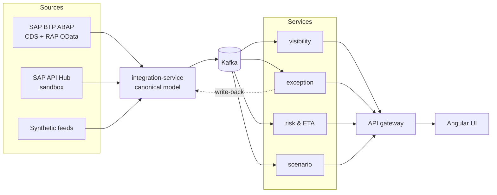

# Supply Chain Control Tower

A control tower that joins the siloed parts of a supply chain (demand, procurement,
production, inventory, logistics and aftermarket) into one view. It flags problems early
enough to act on them.

It covers two fictional companies, using synthetic data:

| Company | Industry | Sites | Typical risk |
|---|---|---|---|
| **Aurora Mobility** | Tier-1 automotive supplier (brake systems, EV modules) | Pune (IN), Saltillo (MX) | Line stops from JIT parts shortages |
| **Stratos Aero** | Aerospace MRO (maintenance, repair, overhaul) | Hyderabad (IN), Toulouse (FR) | AOG: aircraft grounded waiting for one part |

## Architecture



Details: [docs/architecture.md](docs/architecture.md) · Decisions: [docs/decisions.md](docs/decisions.md)

## Repository layout

| Path | What it holds |
|---|---|
| `backend/canonical-model` | Shared data model (Part, Supplier, StockPosition, ...) mapped to SAP tables |
| `backend/synthetic-data` | Repeatable test data for both companies |
| `backend/integration-service` | Spring Boot service that reads sources and serves the snapshot API |
| `frontend` | Angular control tower UI |
| `sap` | ABAP objects (synced from BTP with abapGit from week 2) |
| `docs` | Architecture, decisions, weekly learning notes |
| `docker-compose.yml` | Postgres, Kafka and Kafka UI for local development |

## Run it locally

You need Java 21, Maven 3.9+, Node 22+ and Docker.

```bash
# 1. Infrastructure (Postgres, Kafka). Not needed yet in week 1, but this checks Docker works.
docker compose up -d

# 2. Backend: build + test, install the shared modules locally, then run the integration service on :8081
cd backend
mvn install
mvn -pl integration-service spring-boot:run
#   check: http://localhost:8081/actuator/health
#          http://localhost:8081/api/v1/snapshot/summary

# 3. Frontend on :4200 (in a second terminal)
cd frontend
npm ci
npm start
#   open http://localhost:4200
```

## Roadmap

| Week | Dates | Focus | Status |
|---|---|---|---|
| 1 | Nov 23–29 | Set-up: repository, synthetic data, first API and UI | ✅ scaffolded |
| 2 | Nov 30–Dec 6 | SAP data layer on BTP: Z tables, CDS views, RAP OData V4 | |
| 3 | Dec 7–13 | Integration service reads SAP; events go to Kafka | |
| 4 | Dec 14–20 | Visibility service: days of supply, shipment tracking | |
| 5 | Dec 21–27 | Angular UI v1: KPIs, drill-downs | |
| 6 | Dec 28–Jan 3 | Exception engine: rules, owners, playbooks | |
| 7 | Jan 4–10 | Supplier risk score, ETA prediction, AOG scenario | |
| 8 | Jan 11–17 | What-if scenarios; deploy to AWS; CI/CD | |
| 9 | Jan 18–24 | README, demo video, interview pack | |

## Data note

All companies, suppliers and numbers are fictional. No client or employer data is used.
